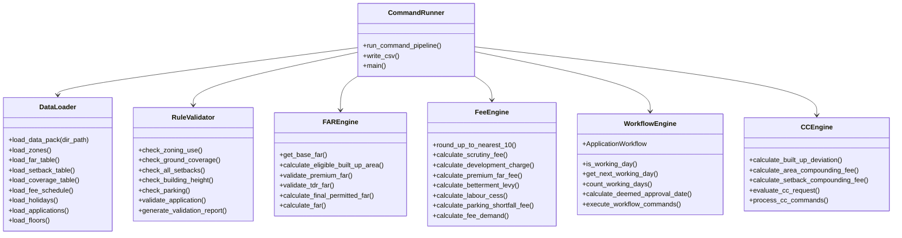
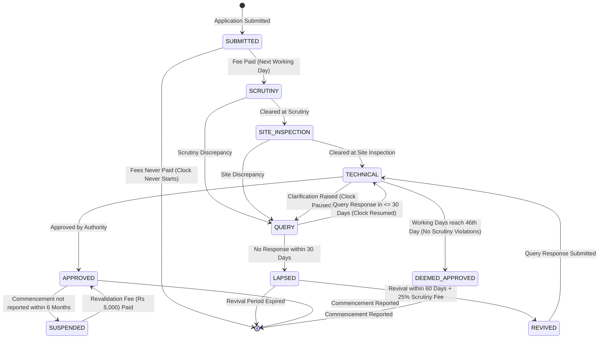

# PS-115 Capstone Design Document & Viva Defense Handbook

**Problem Statement**: PS-115 — Municipal Building-Plan Approval Fee and FAR Compliance Engine
**Team ID**: T060
**Team Members**: Bheemesh V (1AT24CG016), Blessen Thomas (1AT24CG017)
**Institution / Authority**: Urban Local Body (ULB) / Municipal Planning Authority
**Codebase**: Python 3.10+, Standard Library, `pytest`

---

## 1. Executive Summary

The T060 Municipal Compliance Engine is a production-grade, file-driven backend automation system designed to evaluate building-plan sanction applications, compute statutory municipal fee demands, execute statutory approval workflows, and assess as-built completion certificate (CC) deviations.

The engine strictly implements all municipal regulations without premature floating-point rounding or invented rules, backed by 162 automated test cases and verified against official municipal data with 100% precision.

---

## 2. Glossary of Municipal Planning Terminology

| Term | Abbreviation | Definition & Statutory Context |
|---|---|---|
| **Floor Area Ratio** | **FAR** | Ratio of eligible built-up area to total plot area ($\text{FAR} = \frac{\text{Eligible BUA}}{\text{Plot Area}}$). Determines development density. |
| **Eligible Built-Up Area** | **BUA** | Gross covered area minus permitted statutory exclusions ($100\%$ stilt, $100\%$ basement parking, $10\%$ balcony area). |
| **Ground Coverage** | **GC** | Percentage of the plot area covered by the ground-floor building footprint (including stilt). |
| **Setback** | **SB** | Statutory open space around the building (Front, Rear, Side 1, Side 2) where no permanent structure may be erected. |
| **Corner Plot** | — | A plot abutting two roads. Front setback is taken from the larger road; side setback on the second road requires $+0.5\text{ m}$ extra clearance. |
| **Guidance Value** | **GV** | Minimum base rate per square metre of land determined by the state revenue department for property valuation and fee computation. |
| **Premium FAR** | — | Additional FAR (up to $+0.50$) purchasable from the municipality on roads $\ge 12\text{ m}$ at $40\%$ (Residential/Mixed) or $60\%$ (Commercial) of guidance value. |
| **Transferable Development Rights**| **TDR** | Development potential certificates generated from land surrendered for public infrastructure, usable up to $+0.40$ FAR. |
| **Deemed Approval** | — | Statutory grant of approval that occurs automatically on the 46th working day if the authority fails to decide within 45 working days and no scrutiny violations exist. |
| **Compounding** | — | Regularization of minor construction deviations within statutory limits (setback $\le 0.3\text{ m}$, area $\le 10\%$) upon payment of penal fees. |

---

## 3. Statutory Business Rule Register

### 3.1 Zoning & Permitted Use
- An application is permissible only if its `proposed_use` is listed in the zone's `permitted_uses` in `zones.csv`.
- Fatal non-compoundable violation if not permitted.

### 3.2 Ground Coverage Slabs (`coverage_table.csv`)
$$\text{Coverage \%} = \frac{\text{ground\_footprint\_sqm}}{\text{plot\_area\_sqm}} \times 100$$
- $\text{Plot Area} \le 200\text{ sq.m} \implies \text{Max } 65\%$
- $200\text{ sq.m} < \text{Plot Area} \le 500\text{ sq.m} \implies \text{Max } 60\%$
- $\text{Plot Area} > 500\text{ sq.m} \implies \text{Max } 50\%$

### 3.3 Setback Tables & Corner Plot Rules (`setback_table.csv`)
- **Front Setback** (by abutting road width):
  - $< 12\text{ m} \implies 3.0\text{ m}$
  - $12\text{ m} \le \text{Road} \le 18\text{ m} \implies 4.5\text{ m}$
  - $> 18\text{ m} \implies 6.0\text{ m}$
- **Side 1 & Rear Setback** (by plot width):
  - $\le 9\text{ m} \implies 1.0\text{ m}$
  - $> 9\text{ m} \le 12\text{ m} \implies 1.5\text{ m}$
  - $> 12\text{ m} \implies 2.0\text{ m}$
- **Corner Plots**:
  - Front road is the larger road.
  - Side setback along the second road requires standard side setback $+ 0.5\text{ m}$.
  - Equal road widths: either road may be front; second road gets $+ 0.5\text{ m}$.

### 3.4 Building Height Limits
$$\text{Geometric Limit} = 1.5 \times (\text{effective\_road\_width} + \text{required\_front\_setback})$$
$$\text{Permitted Height} = \min(\text{Geometric Limit}, \text{Zone Height Cap})$$
- Residential Zone Caps: $15\text{ m}$ on roads $< 12\text{ m}$; $24\text{ m}$ on roads $\ge 12\text{ m}$.
- Commercial Zone Cap: $30\text{ m}$.

### 3.5 Parking Requirements
- Residential: $1.0\text{ car}$ per unit $> 100\text{ sq.m}$; $0.5\text{ car}$ per unit $\le 100\text{ sq.m}$.
- Commercial: $1.0\text{ car}$ per $50\text{ sq.m}$ commercial built-up area.
- Shortfall $\le 20\%$: Allowed upon payment of ₹2,00,000 per missing car.
- Shortfall $> 20\%$: Fatal non-compoundable violation.

### 3.6 Municipal Fee Demand Schedule
All fees rounded UP to next ₹10 ($\lceil \text{fee} / 10 \rceil \times 10$).
- **Scrutiny Fee**: $\max(2000.0, \text{total\_bua} \times 20.0)$
- **Development Charge**:
  - Pure Residential: $\text{total\_bua} \times 300.0$
  - Pure Commercial: $\text{total\_bua} \times 600.0$
  - Mixed-Use: Commercial floors @ ₹600.0/sq.m; residential & parking floors @ ₹300.0/sq.m.
- **Premium FAR Fee**: $(\text{premium\_far} \times \text{plot\_area}) \times \text{guidance\_value} \times \text{rate}$ ($40\%$ Residential/Mixed; $60\%$ Commercial).
- **Betterment Levy**: $2\%$ of plot guidance value if `agri_converted == True`.
- **Labour Welfare Cess**: $1\%$ of construction cost ($\text{total\_bua} \times 10.7639 \times ₹1800$).
- **Parking Shortfall Fee**: $\text{shortfall\_cars} \times ₹2,00,000.0$.

### 3.7 Completion Certificate (CC) Compounding Slabs
- **Area Deviation**:
  - $\le 0.0\% \implies ₹0.0$
  - $\le 5.0\% \implies 2\times \text{development charge on excess area}$
  - $\le 10.0\% \implies 4\times \text{development charge on excess area}$
  - $> 10.0\% \implies \text{Non-compoundable; CC REFUSED}$
- **Setback Deviation**: $\le 0.30\text{ m} \implies ₹10,000/\text{metre-side}$; $> 0.30\text{ m} \implies \text{CC REFUSED}$.
- **Height Deviation**: $> 0.0\text{ m} \implies \text{Never compoundable; CC REFUSED}$.

---

## 4. System Architecture & Component Diagram

---

## 5. Statutory Workflow State Machine

---

## 6. One-Line Decision Log

1. **Precision Integrity**: Retained unrounded floating-point calculations for compliance comparisons to prevent false approvals caused by rounding.
2. **Interval Boundaries**: Built dedicated `check_interval` parser strictly honoring explicit inclusive/exclusive bounds from data tables.
3. **Data Protection**: Preserved original sample data pack in external directory, operating strictly from repository `data/`.
4. **Zoning Independence**: Zone permitted uses are verified dynamically against `zones.csv` without hardcoding municipal IDs.
5. **Coverage Footprint**: Ground coverage calculation counts stilt parking footprint in the numerator per municipal building bylaws.
6. **Corner Plot Road Disambiguation**: On corner plots with equal abutting road widths, either road qualifies as front with $+0.5\text{ m}$ added to the secondary road side.
7. **Setback Compounding**: Setback deviations $\le 0.30\text{ m}$ are classified as compoundable at ₹10,000 per metre-side; deviations $> 0.30\text{ m}$ are non-compoundable.
8. **Height Road Geometry**: Geometric height limit $1.5 \times (\text{road} + \text{front setback})$ is capped by the applicable zone cap; whichever is lower governs.
9. **No Invented Base-Floor Limit**: Left `base_floor_limit` as an explicit parameter without assuming four floors.
10. **Parking Requirement Precision**: Maintained exact float calculation for parking requirement without premature `ceil()` rounding.
11. **Floor-Level Mixed Development Charges**: Applied floor-level rates (Commercial ₹600, Residential/Parking ₹300) for mixed-use buildings rather than an arbitrary blended rate.
12. **Evidence-Based Mixed-Use Premium Rate**: Applied $40\%$ guidance value for mixed-use premium FAR based on $100\%$ rupee-match across official payment records.
13. **Individual Fee Rounding**: Rounded each individual fee component up to the nearest ₹10 before computing the total fee demand.
14. **Violation Gating**: Inhibited fee demand generation when non-compoundable violations exist; compoundable setback deviations do not block fees.
15. **Statutory 46th Day Deemed Approval**: Triggered deemed approval strictly on the 46th running working day after 45 working days elapse without scrutiny violations.
16. **Calendar vs Working Days Distinction**: Enforced 30 calendar days for query deadlines and 60 calendar days for revival, while tracking Mon–Fri working days for approval timers.
17. **One-Time Extension Limit**: Granted first 1-year extension at $10\%$ fee; strictly rejected second extension requests.
18. **Strict Height Non-Compounding**: Rejected completion certificates for any positive as-built height deviation without exception.
19. **Deterministic Output Guarantee**: Guaranteed identical bitwise outputs for all four CSV files across consecutive runs.

---

## 7. 5-Minute Demonstration Protocol

### Step 1: Mainline Compliant Approval Flow (APP-0005)
1. **Application**: APP-0005 (Residential, $200\text{ sq.m}$ plot, $12\text{ m}$ road).
2. **Validation**: Ground coverage $63\% \le 65\%$, setbacks comply, height complies $\implies$ Clean (`NONE` in `validation_report.csv`).
3. **Fee Demand**: Total fee ₹1,29,470 (Scrutiny ₹5,040, Dev Charge ₹75,600, Labour Cess ₹48,830) $\implies$ Exact match with paid challan.
4. **Workflow**: Fee paid Jan 20 $\rightarrow$ Scrutiny cleared Feb 03 $\rightarrow$ Site inspection cleared Feb 13 $\rightarrow$ Technical approved Feb 26 $\implies$ Approved in 26 working days.

### Step 2: Edge Case 1 — Deemed Approval (APP-0001)
1. **Scenario**: Clean plan; fee paid Friday 2026-01-09; Scrutiny and Site Inspection cleared; Technical authority fails to issue a decision.
2. **Clock Mechanics**: Working day clock starts Monday 2026-01-12. Skips holidays on Jan 15 (Makara Sankranti) and Jan 26 (Republic Day).
3. **Outcome**: 45 working days elapse on 2026-03-17. On the 46th working day (**2026-03-18**), application is stamped `DEEMED_APPROVED`.

### Step 3: Edge Case 2 — Combined FAR Cap Violation (APP-0003)
1. **Scenario**: Applicant on $15\text{ m}$ road requests $+0.50$ Premium FAR and $+0.40$ TDR FAR (Total $+0.90$).
2. **Rule Enforcement**: Municipal combined additional FAR limit is $+0.60$. Excess request of $+0.30$ violates `FAR_CAP`.
3. **Gating**: System records `FAR_CAP` violation in `validation_report.csv` and blocks fee demand generation (`fee_demand.csv` has no entry for APP-0003).

---

## 8. Viva Examination Preparation Guide

### Question 1: Why does your engine not round FAR before comparing it with permitted limits?
**Answer (Bheemesh V)**:
"Rounding before comparison creates dangerous false approvals. If an applicant achieves an FAR of 2.2504 on a plot permitted for 2.2500, rounding to two decimals would round 2.2504 down to 2.25, falsely approving an illegal plan. Our engine keeps unrounded floating-point ratios for compliance decisions and applies rounding strictly for display and final fee values."

### Question 2: How does the engine calculate development charges for mixed-use buildings?
**Answer (Blessen Thomas)**:
"In mixed-use buildings, applying a single blended rate is inaccurate because floor uses differ. Our engine parses `floors.csv` and calculates development charges at the floor level: commercial floors are charged at ₹600/sq.m, while residential, parking, and utility floors are charged at ₹300/sq.m. This formula was audited and verified against official sample payments with zero deviation."

### Question 3: How does deemed approval interact with queries and scrutiny violations?
**Answer (Bheemesh V)**:
"Deemed approval is granted on the 46th working day under two strict conditions: first, no non-compoundable violations were recorded during scrutiny; second, the 45 working days clock excludes any days during which the clock was paused for an applicant query response. For example, in APP-0019, a query paused the clock for 30 calendar days, so those 30 days did not count towards the 45 working days."

### Question 4: How are as-built deviations compounded at the completion certificate stage?
**Answer (Blessen Thomas)**:
"Built-up area deviations up to 5% are compounded at 2× development charge on the excess area. Deviations between 5% and 10% are compounded at 4× development charge. Any area deviation exceeding 10% is non-compoundable and triggers CC_REFUSED. Setback deviations up to 0.30 m are compounded at ₹10,000 per metre-side. Height deviations are strictly non-compoundable; even a 0.01 m excess results in CC_REFUSED."
